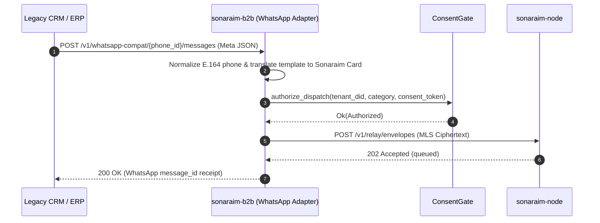
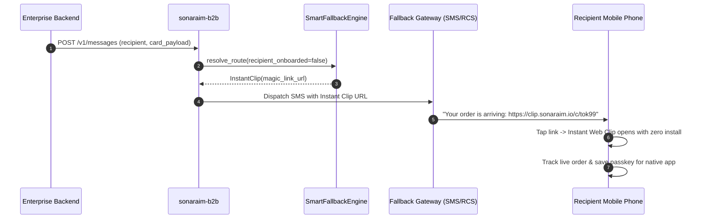
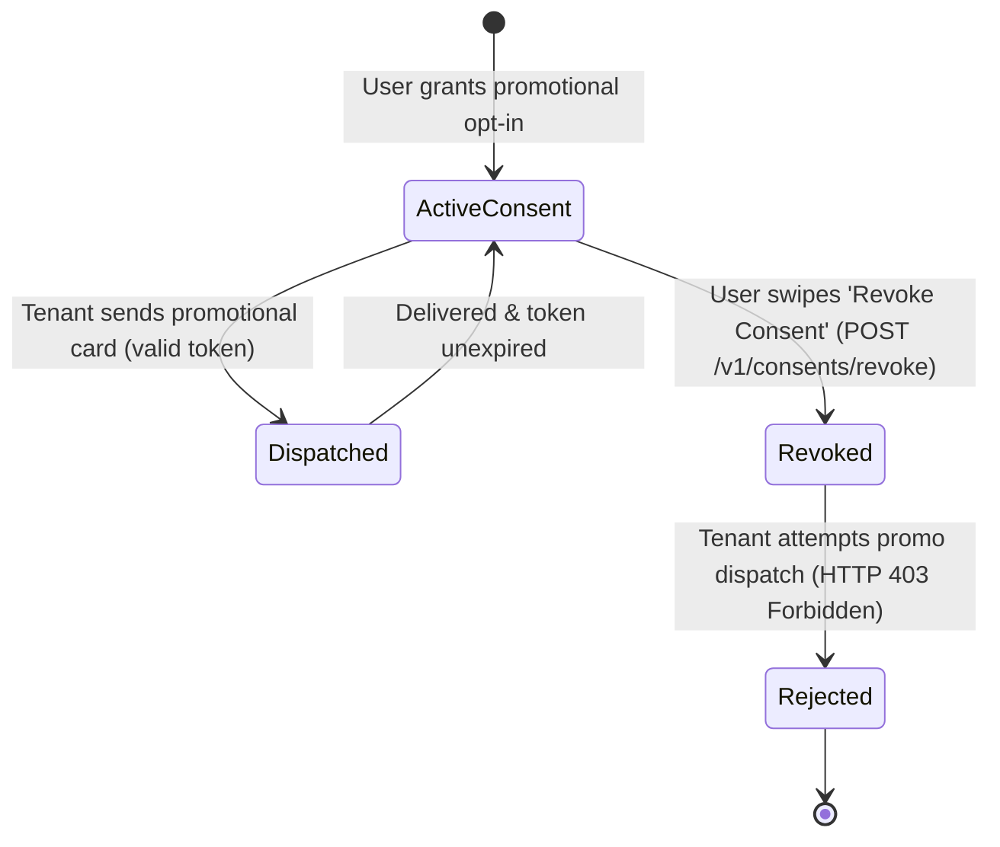
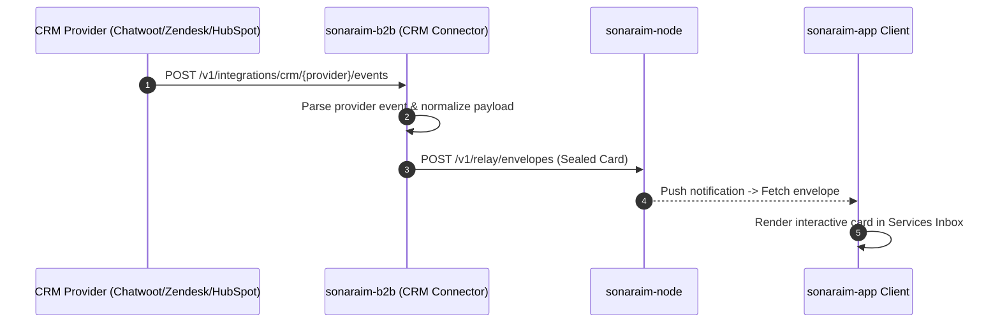
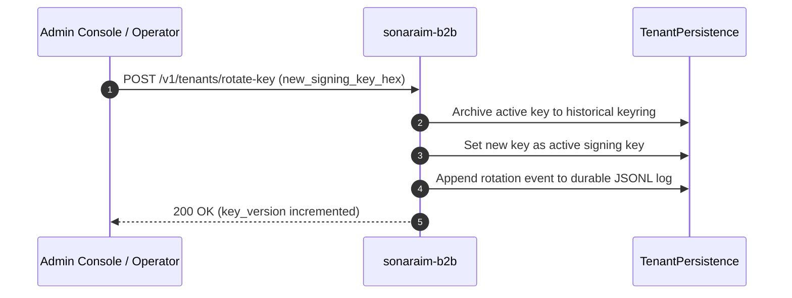

# System Diagrams — `sonaraim-b2b`

> Mermaid sequence, state, and architecture diagrams for `sonaraim-b2b`.

---

## 1. WhatsApp Migration & Message Translation Flow

---

## 2. Smart Fallback Delivery Sequence

---

## 3. Consent Token Verification & Revocation Flow

---

## 4. CRM Inbound Webhook to Sonaraim Card Dispatch Flow

---

## 5. Tenant Key Rotation Sequence

